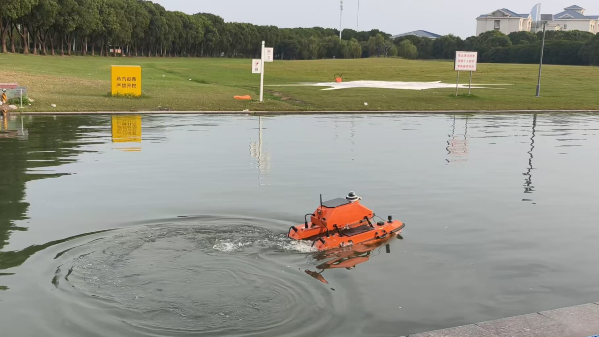
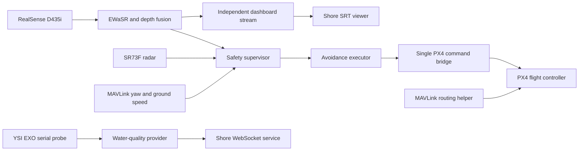

# SmartBoat: ROS 2 Edge Perception and Control

A Jetson-based ROS 2 stack for an unmanned surface vessel, combining RealSense/EWaSR perception, millimeter-wave radar, water-quality telemetry and a PX4/MAVLink control interface.

This portfolio edition republishes a source snapshot from [xyx-chn/2026SURF_SmartBoat_ROS2_EdgeSide](https://github.com/xyx-chn/2026SURF_SmartBoat_ROS2_EdgeSide), with permission to publish confirmed by the portfolio owner. It adds English reading guides and the supplied SURF poster. Original team authorship is retained; see [provenance and preparation notes](docs/provenance.md) for the source revision and scope of this edition.



*Project field photograph extracted unchanged from the supplied poster. It documents a historical trial, not a new experiment performed for this repository edition.*

## Start here

| To understand… | Open… |
|---|---|
| The vessel, project purpose and original visual evidence | [English SURF poster](docs/presentation/smartboat_surf_project_poster.pptx) |
| How the software layers communicate | [Architecture and current status](docs/architecture.md) |
| Each ROS package and the important source files | [Workspace reading guide](boat_ws/README.md) |
| How to restore the model/wheels and build on Jetson | [Deployment guide](docs/deployment.md) and [runtime assets](docs/runtime-assets.md) |
| What can be checked without a boat | [Host checks](tests/README.md) and [validation record](docs/validation.md) |
| Source revision, credits and changes in this edition | [Provenance](docs/provenance.md) |

## What the code contains

- **Perception:** a maintained RealSense D435i ROS node runs EWaSR ONNX inference and combines segmentation with aligned depth. A separate dashboard process synchronizes complete frames and streams visualization through FFmpeg/SRT.
- **Radar and water quality:** the SR73F driver reads SocketCAN scans and targets. The YSI EXO provider reads RS-232 samples and sends water-quality records through the existing WebSocket protocol.
- **Avoidance and vehicle interface:** the safety supervisor combines radar, camera and speed freshness. A separate execution state machine produces mode-aware control requests. The PX4 bridge handles output ownership, heartbeat/command gates, manual takeover and a transition event recorder.
- **Mission composition:** the main launch starts maintained ROS nodes and the installed MAVLink routing helper. Standalone diagnostic scripts and the retired PID remain separate from the maintained control chain.

The `smartboat_localization` and `smartboat_tools` directories are reserved scaffolds. A shore-side application, PX4 firmware, trained-model generation and a complete global mission planner are not implemented by this edge repository.

## System overview



Topic names and package interfaces are listed in the [architecture guide](docs/architecture.md). Existing Chinese telemetry labels and dashboard text remain unchanged for compatibility with the upstream shore interface. The English guides explain them without changing the data contract.

## Review without hardware

The offline test selection uses no ROS graph, serial devices, CAN interfaces, model inference or external network services:

```bash
python3 -m venv /tmp/smartboat-host-checks
source /tmp/smartboat-host-checks/bin/activate
python -m pip install -r tests/requirements-host.txt
bash tests/run_host_checks.sh
```

**65 existing upstream tests passed** in the recorded host environment. They cover radar parsing, EXO records, depth/mask fusion, safety decisions, avoidance execution, dashboard synchronization/text caching and event recording. This does not establish real vessel performance or validate live PX4/ROS transport.

## Jetson deployment

The intended target remains **Jetson/aarch64, Ubuntu 22.04, ROS 2 Humble and Python 3.10**, with the upstream CUDA/TensorRT/RealSense stack. The Docker recipe requires the original model/wheel asset bundle before it can be reproduced. See [deployment](docs/deployment.md) for the exact paths and external host services.

After restoring runtime assets and preparing the Jetson host, the upstream build inside the container is:

```bash
cd /workspace/boat_ws
source /opt/ros/humble/setup.bash
colcon build --symlink-install --packages-skip librealsense2
source install/setup.bash
```

The main entry point is `ros2 launch smartboat_mission edge_nodes.launch.py`. **Its supplied configuration enables the hardware command bridge and sets `output_enabled: true`, subject to further gates.** Read the [control guide](boat_ws/src/smartboat_px4_bridge/README.md) before a live start. No boat, controller or external shore service was contacted during this portfolio preparation.

## Evidence and limitations

The supplied English poster presents SURF project 0634, historical water trials, hardware decomposition and shore interfaces. This edition includes the original poster and selected original figures in the [evidence gallery](docs/evidence.md).

Some poster status statements predate the supplied code: it describes mock water sensing and an unimplemented ROS-native bridge, whereas this source snapshot includes `ExoSensorProvider`, maintained perception, an avoidance executor and a ROS/PX4 command bridge. Read the [status table](docs/architecture.md#implementation-status) for the current source boundary.

Host checks and static inspection were repeated for this edition. Jetson container execution, GPU inference, ROS package builds, the real probe/radar and water trials were not repeated. The model bundle is preserved as a runtime asset, not included in ordinary Git history. No new accuracy, endurance or avoidance-success numbers are claimed.

## Team and source credit

The supplied poster credits **Yuxiao Xie, Kaihan Ouyang, Siyuan Lin, Ruoxi Zhu, Shengzhe Li and Yijia Cao**, with supervisors **Xiaohui Zhu and Yong Yue**, at Xi'an Jiaotong-Liverpool University. Individual module contributions were not specified, so this edition retains team attribution.

The poster reports a **National Second Prize in the 15th National Marine Vehicle Design and Manufacturing Competition**. That statement is attributed to the poster; a separate award certificate was not supplied for this repository.

The upstream repository has no top-level project license, and several package license fields remain placeholders. Existing third-party notices and upstream authorship are retained. This portfolio edition does not add or imply a repository-wide open-source license.
