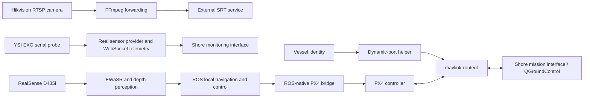

# Architecture and project status

The project owner has confirmed real YSI EXO acquisition/upload and ROS-native PX4 bridge, local navigation and control integration as completed. The original [SURF poster](presentation/smartboat_surf_project_poster.pptx) remains unchanged for project context, team credit and reported field activities. Its pending-status text for those areas is superseded by this completion update.

## System workflow

The perception source combines D435i colour/depth information with EWaSR segmentation. The manual smoke and inference tools remain available alongside ROS perception modules. The local navigation package separates safety assessment from mode-aware avoidance execution; vehicle output is handled by the PX4 bridge.

The YSI EXO provider reads serial measurements and supplies timestamped name/value records to the WebSocket client. It validates configured parameter order and retains the Chinese measurement labels and units in `exo_serial.py`. The complete shore application is not included here.

The mission helper reads vessel identity, requests a dedicated server port and starts `mavlink-routerd`. The ROS-native bridge accepts command/activation inputs, applies output gates and sends Offboard body-frame velocity setpoints. Physical RC/manual takeover behavior and event-recording code are included. The retained manual-control PI helper is not called by the active Offboard output path.

## Current status

| Area | Status |
|---|---|
| Jetson/Docker edge platform | Established project environment |
| SRT video forwarding | Completed |
| Real YSI EXO acquisition and WebSocket upload | Completed |
| MAVLink dynamic-port routing | Completed |
| D435i smoke tests and inference tools | Implemented / runnable |
| ROS-native PX4 bridge | Completed |
| Local navigation and control integration | Completed |
| Custom ROS message definitions | Four definitions included; further interface integration/validation remains |
| Dedicated localization package | Scaffold; under development |
| Measured accuracy, endurance and avoidance success | Further evaluation required |

Completion status is distinct from independent verification. Repository preparation did not include a ROS build, connected-sensor test, live PX4 session or on-water test. The poster reports trials at Dushu Lake and the campus pond, but provides no quantified accuracy, endurance or avoidance-success result.

## Source reading map

The [workspace guide](../boat_ws/README.md) maps EXO/radar drivers, ROS perception/streaming, safety/execution models, message definitions and the PX4 bridge to their source files. SR73F code is included, but this update does not add a separate claim that radar hardware was validated. The local avoidance stack does not include a complete global mission planner or fused GPS/RTK/IMU localization system.

## Build and control boundary

`edge_nodes.launch.py` enables navigation/control nodes and loads a bridge configuration with `output_enabled: true`, subject to additional gates. Review [deployment.md](deployment.md) before using the launch on hardware. No source algorithms, configuration or launch defaults were changed for this documentation update.

## External systems and missing materials

The edge source expects shore services, an SRT receiver, MAVLink routing configuration and deployment identities. The complete shore application, PX4 firmware, vessel fabrication CAD, model training data and raw quantitative field-test records are not included. Existing configuration values and source comments are not presented as independently reproduced performance measurements.
