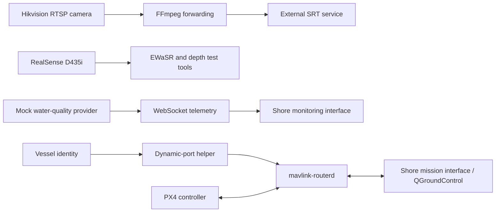

# Architecture and project status

Project methods and completion status follow the [English SURF poster](presentation/smartboat_surf_project_poster.pptx). The source directory also contains development modules; it is a file inventory, not evidence that every module was deployed during the reported trials.

## Poster-described workflow

The perception tools acquire D435i colour, depth and IMU data. EWaSR ResNet-18 ONNX inference segments navigable water and candidate obstacles. The poster identifies these as test/inference tools, not a completed packaged ROS 2 navigation node.

Water-quality records contain time, station, vessel identity and multiple name/value observations. The poster records upload with mock data and lists the real sensor provider as pending. The shore interface is shown monitoring time-series and historical records; its complete source is not included here.

For the mission link, the helper reads vessel identity and requests a dedicated server port. `mavlink-routerd` forwards PX4/MAVLink communication to the shore side, where operators can define waypoints. The poster treats the helper as an external process and the ROS-native bridge as under development.

## Completion status from the poster

| Area | Reported status |
|---|---|
| Jetson/Docker edge platform | Established project environment |
| SRT video forwarding | Implemented / runnable |
| WebSocket water-quality upload | Implemented with mock data |
| MAVLink dynamic-port routing | Implemented / runnable |
| D435i smoke tests and inference tools | Implemented / runnable |
| Real water-quality provider | Under development |
| ROS-native PX4 bridge and custom messages | Under development |
| Navigation, localization and control integration | Under development |
| Measured accuracy, endurance and avoidance success | Further evaluation required |

The poster reports trials at Dushu Lake and the campus pond. It provides no quantified accuracy, endurance or avoidance-success result.

## Reading the supplied development source

The [workspace guide](../boat_ws/README.md) maps the available files to their responsibilities. It includes EXO/radar drivers, ROS perception and streaming modules, safety/execution models, message definitions and a PX4 command bridge. These are development-source contents, not additional completed milestones in this presentation.

Package guides describe file interfaces and configuration so readers can inspect the code. They do not replace the poster's project-status table.

## Build and control boundary

The supplied `edge_nodes.launch.py` references more components than the poster's three-link summary. In particular, it enables control-related development nodes and loads a bridge configuration with `output_enabled: true`. File presence and enabled defaults do not establish completed or validated project integration. See [deployment.md](deployment.md) before using that launch on hardware.

No source algorithms, configurations or launch defaults were changed to align these documents with the poster.

## External systems and missing materials

The edge source expects shore services, an SRT receiver, MAVLink routing configuration and deployment identities. The complete shore application, PX4 firmware, vessel fabrication CAD, model training data and raw quantitative field-test records are not included. Configuration values and source comments are not presented as independently reproduced performance measurements.
