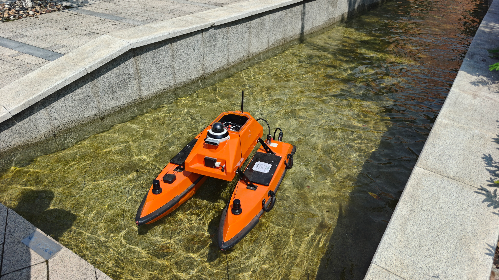
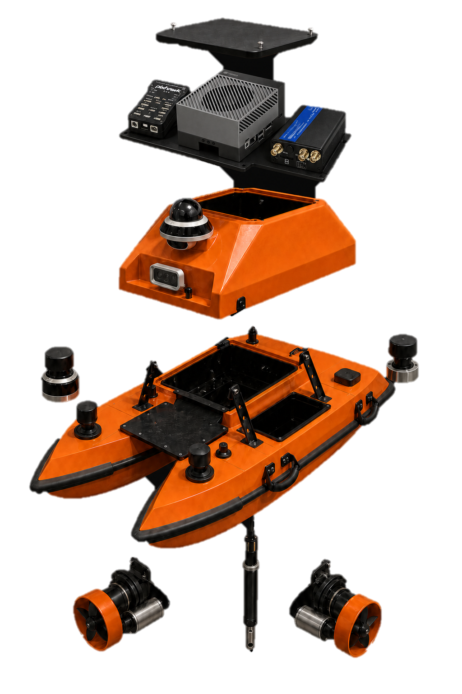
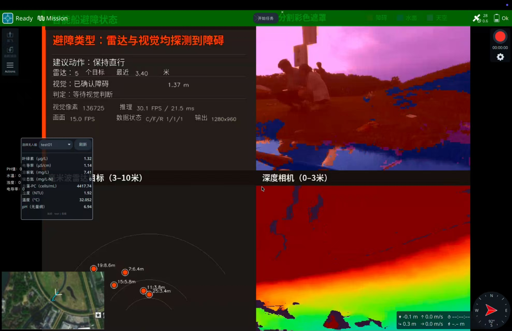
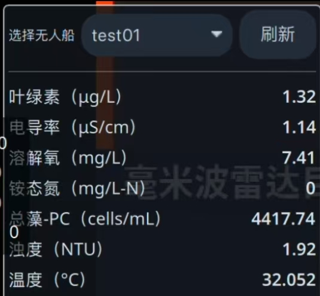
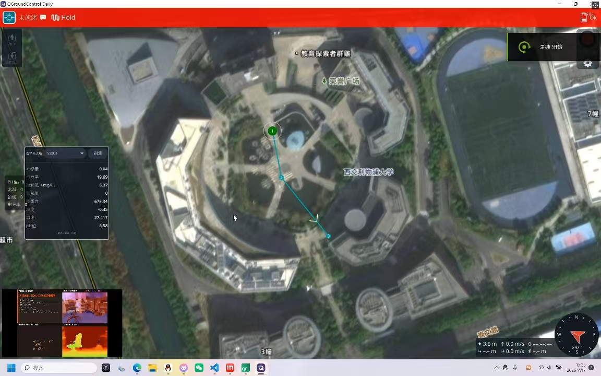

# Original project evidence

The [English SURF poster](presentation/smartboat_surf_project_poster.pptx) is preserved unchanged. The images below were extracted from that supplied file, not generated or captured during this portfolio preparation. Original interface screenshots may contain Chinese text.

## Historical field photographs

These photographs support the poster's account of field activity. They do not establish a measured success rate, endurance or sensor accuracy.

## Hardware concept

The poster labels this a conceptual decomposition based on the project configuration, not to scale. Editable vessel CAD and electronics fabrication files are not supplied by the edge-software repository.

## Original shore and perception interfaces

The screenshots illustrate project context. Their displayed values are not a new test dataset. The source here implements the edge side; it does not include the shore application's complete frontend/backend.

The poster defines the reported project completion status, summarized in [architecture.md](architecture.md). Source modules beyond those completed milestones remain development work. Repository-preparation checks are documented separately in [validation.md](validation.md).
